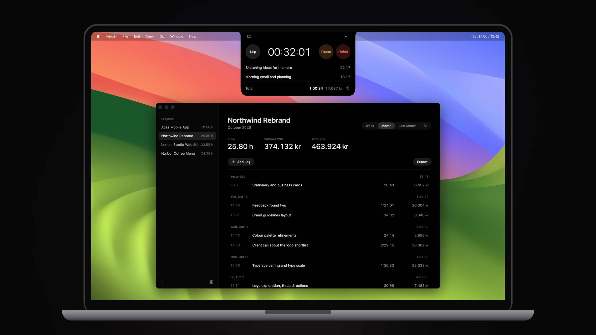
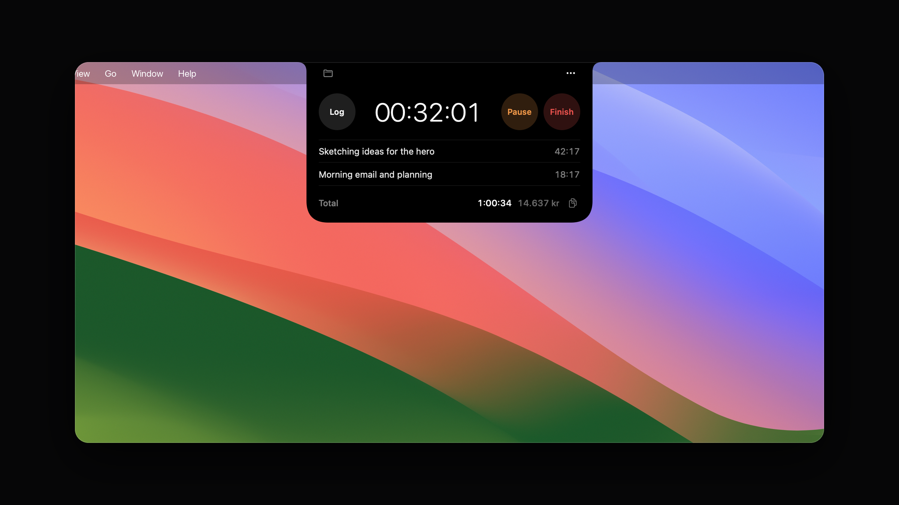
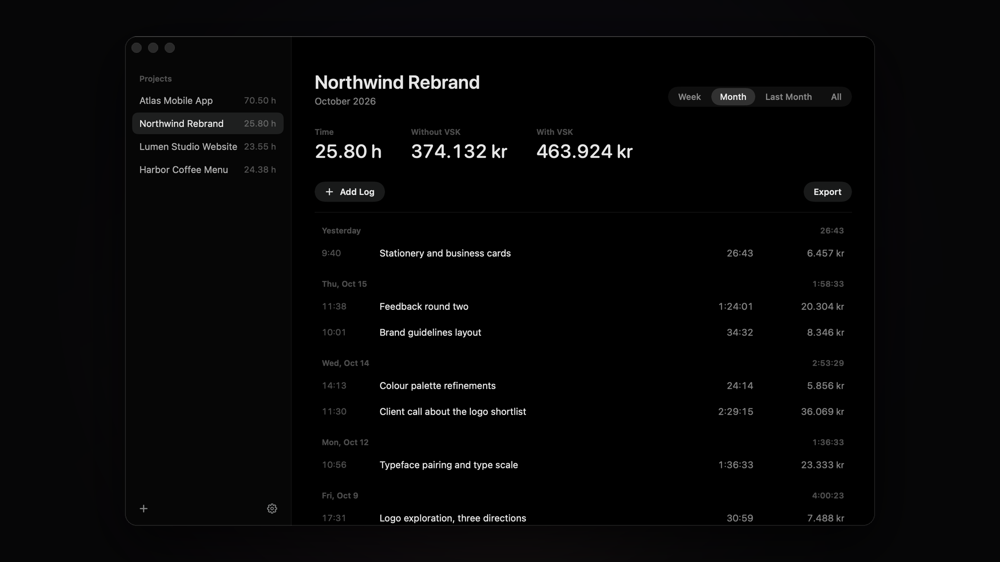
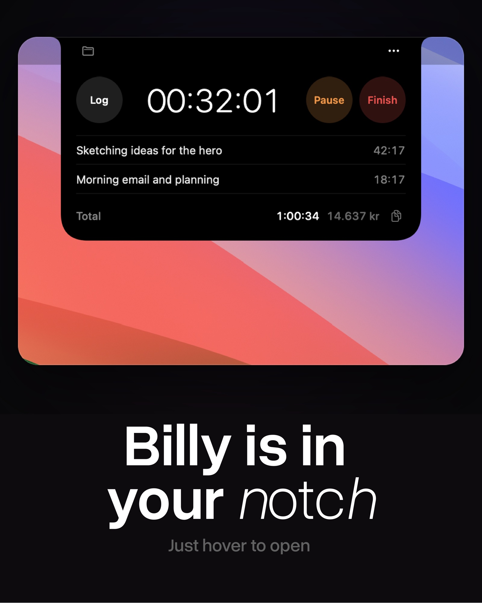
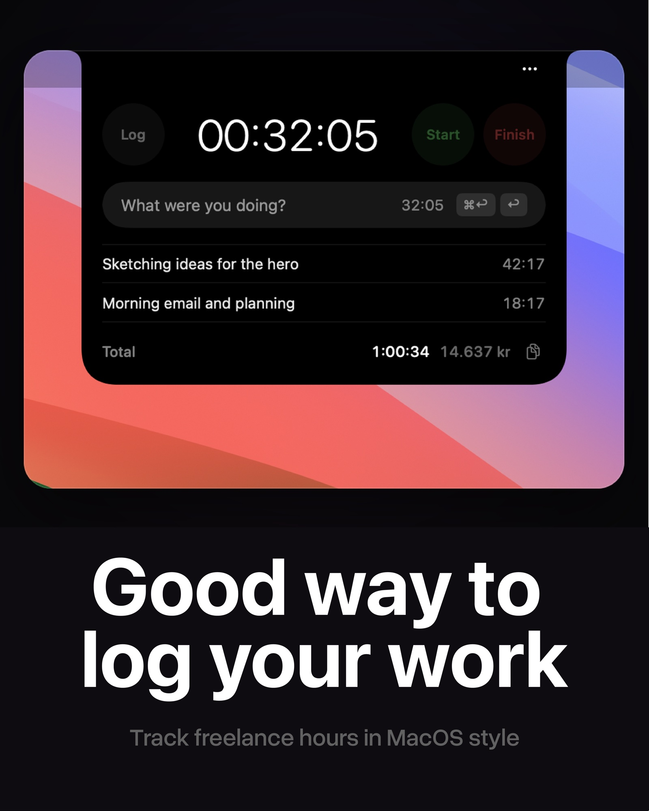
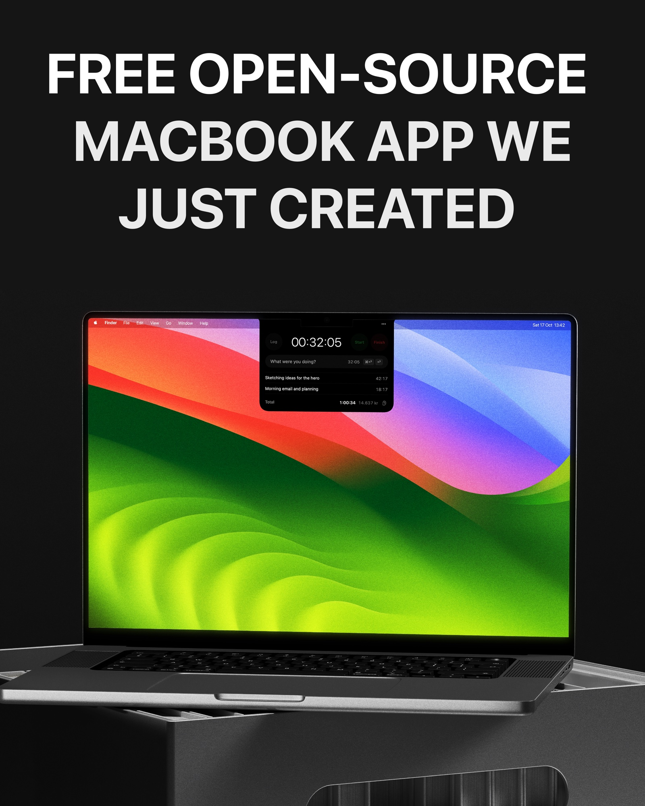
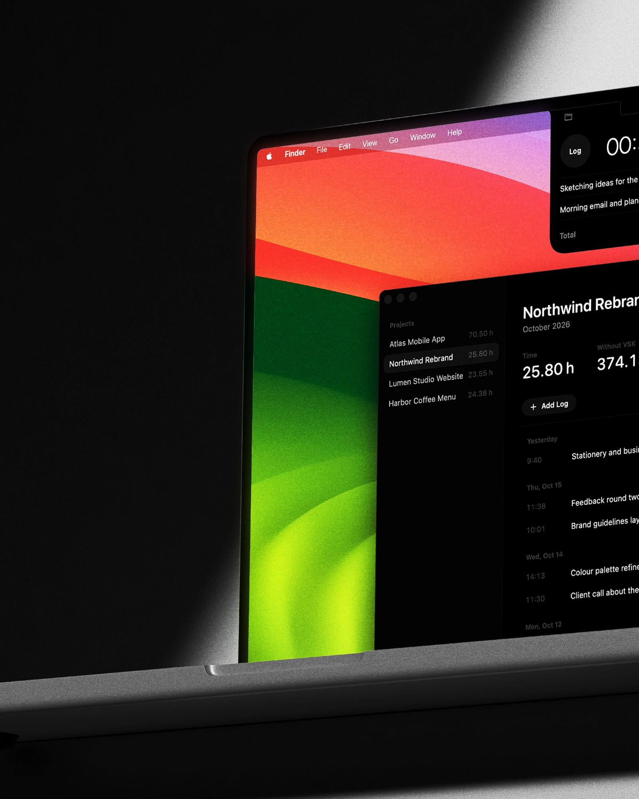
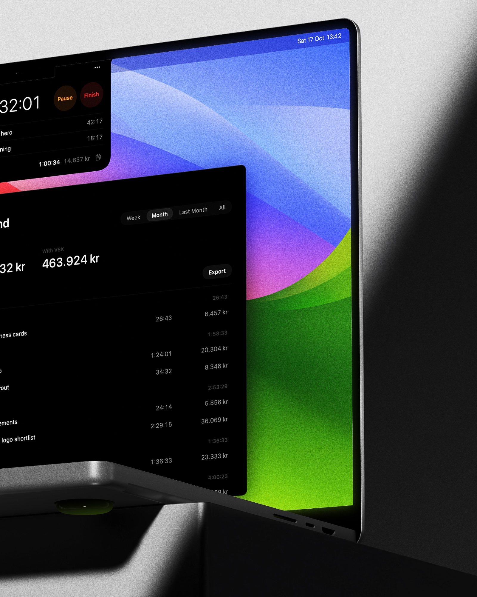
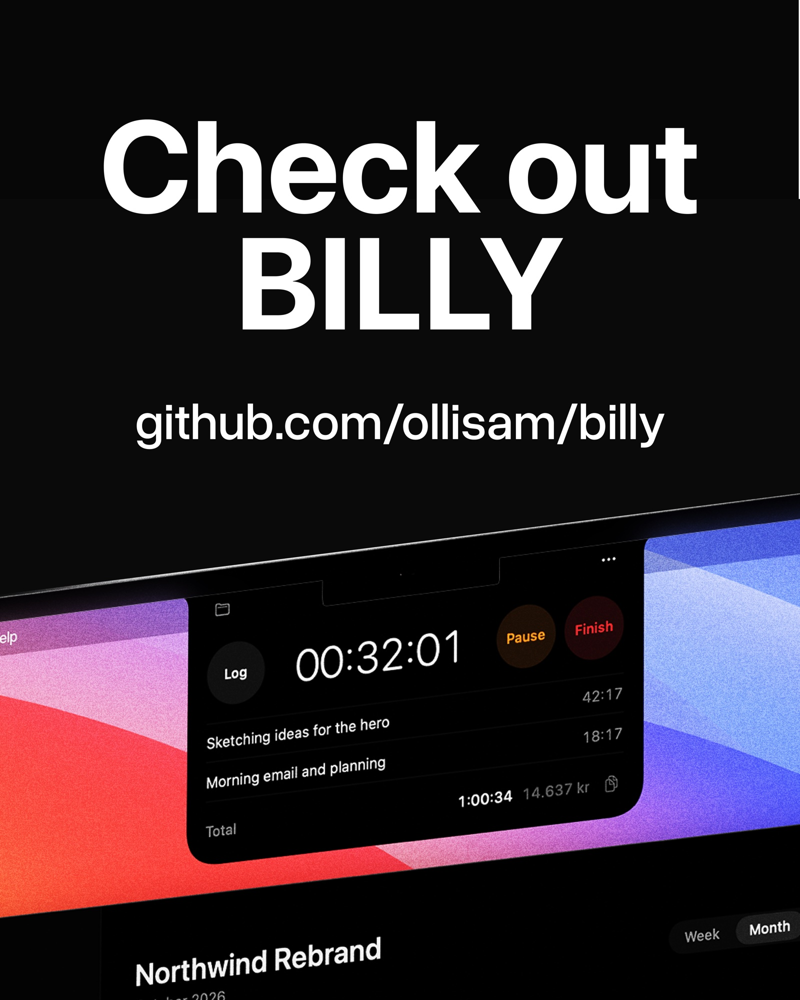

# Billy

A billing timer that lives in your Mac's notch. Hover the notch, start the clock, log what you did, and see what your hours are worth.



## Features

- **Notch timer** – start, pause and log time without leaving what you're working on.
- **Split a session** – press ⌘↩ (or ⇧↩) to drag out part of the running time and log it separately.
- **Projects** – file sessions into projects, edit logs, and see time and money by week or month.
- **Exports** – copy a report, or save it as PDF or CSV.
- **VAT** – amounts with and without VSK/VAT, in ISK, EUR, USD, GBP and more.





## See it in action

Two short screen recordings: [logging and splitting time](docs/content/billy-demo-2.mp4) and [logging while browsing](docs/content/billy-demo-1.mp4).

<p>
  
  
  
</p>
<p>
  
  
  
</p>

## Requirements

- macOS 14 (Sonoma) or later
- Xcode 15.3 or later (Swift 5.10)

Billy works on Macs without a notch too; it sits at the top centre of the screen.

## Build it yourself

Billy isn't distributed as a download: you build it from source, which takes about a minute.

```sh
git clone https://github.com/ollisam/billy.git
cd billy
./build.sh
open build/Billy.app
```

`build.sh` compiles a release build and packages it as `build/Billy.app`, signed for your Mac only. Because you built it yourself, macOS opens it without any "unidentified developer" warning. Move it to `/Applications` to keep it, and turn on **Open at Login** from the ••• menu in the notch.

To update, run `git pull` and `./build.sh` again.

## Keyboard shortcuts

| Where | Keys | Action |
| --- | --- | --- |
| Notch | ↩ | Log the session |
| Notch | ⌘↩ / ⇧↩ | Split: log only part of the time |
| Notch | Esc | Cancel |
| Projects | ⌘P | Open projects |
| Projects | ⌘, | Settings |
| Edit Log | ⌘S | Save |

## Data

Everything stays on your Mac, in `~/Library/Application Support/Billy/state.json`.

## License

Billy is free and open source under the [MIT License](LICENSE): the code, the icon and the images in this repository.
